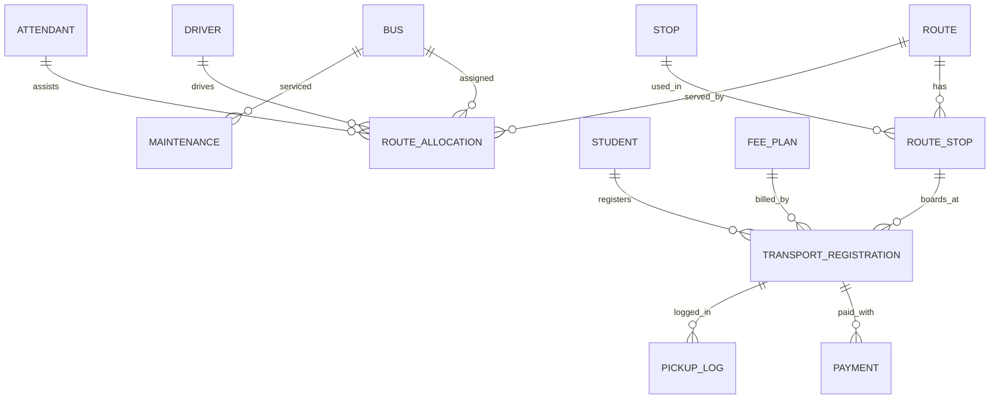

# 🚌 School Transport Route & Student Pickup Management System

A relational database project (normalized to **3NF**) with a Python desktop app and an interactive web simulator. It tracks buses, routes, stops, crews, students, daily pickups, fees and maintenance, and enforces the business rules **inside the database**.

**[Live demo](https://vinayabraham007-sketch.github.io/school-transport-dbms/)** (GitHub Pages, serves `docs/index.html`)

## Features
- Route setup with ordered stops, bus / driver / attendant allocation
- Student-to-stop assignment, pickup/drop attendance (Present, Absent, Late)
- Fee plans, payment collection, dues report
- Maintenance log with overdue / unfit flags
- Seven SQL reports, CRUD, search, validation and error handling

## Business rules (enforced by the database)
| Rule | Mechanism |
|---|---|
| Bus capacity limit | `BEFORE INSERT` trigger `trg_capacity` + `CHECK(capacity BETWEEN 1 AND 80)` |
| One active assignment per student | Partial unique index `one_active_per_student` |
| Valid driver licence | Trigger `trg_licence` (expiry must be after allocation date) |
| Unique stop sequence | `UNIQUE(route_id, stop_seq)` |
| Payment limit | Trigger `trg_payment` + `CHECK(amount_paid>0)` |

## ER diagram


## Project structure
```
app/transport_app.py     Python + Tkinter + SQLite desktop app
database/schema.sql      DDL: tables, constraints, indexes, triggers, views
database/seed.sql        Sample data
database/reports.sql     Report queries (joins, aggregates, nested queries, views)
docs/index.html          Web simulator (GitHub Pages)
```

## Run it
```bash
python app/transport_app.py        # creates transport.db on first run (Python 3, no packages needed)
# or build the database manually
sqlite3 transport.db < database/schema.sql
sqlite3 transport.db < database/seed.sql
sqlite3 transport.db < database/reports.sql
```
For MySQL/PostgreSQL, port the triggers (syntax differs); the tables and constraints are standard SQL.

## Normalization
Every table has atomic columns and a single-column primary key; non-key attributes depend only on the key (no partial or transitive dependencies). The `ROUTE_STOP` and `TRANSPORT_REGISTRATION` tables resolve the many-to-many relationships. Example: `student_id → name, class, guardian`; `reg_id → student_id, route_stop_id, plan_id`.

## Testing
| Test | Expected |
|---|---|
| Add a 5th student to a full 4-seat bus | Rejected: capacity full |
| Register an already-active student again | Rejected: unique index |
| Allocate a driver with an expired licence | Rejected: licence trigger |
| Reuse a stop sequence on a route | Rejected: UNIQUE |
| Pay more than the fee due | Rejected: payment trigger |

## Tech
Python 3 · SQLite · Tkinter · HTML/CSS/JS · Mermaid

## License
MIT
